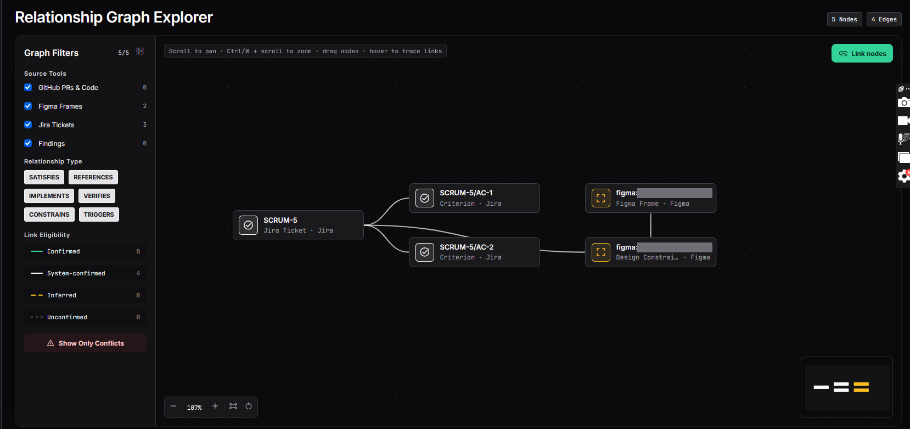
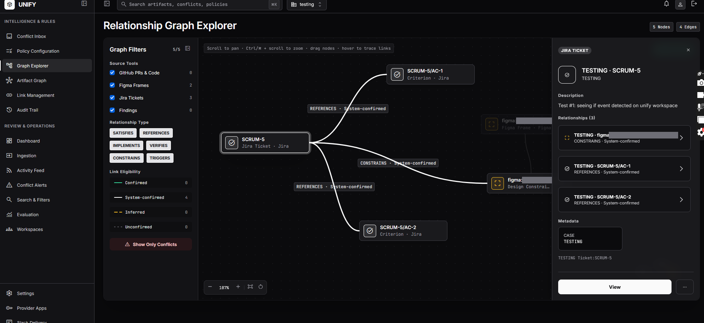

# Live Jira and Figma graph outcome — 27 November 2026

Workspace `testing`, live database and real provider accounts. This is a run of
27 November; it does not capture the 16 November session.

## Steps

1. The watched Figma file had already been polled on 13 November, which wrote its
   design nodes.
2. On 27 November the description of Jira issue `SCRUM-5` was edited by hand to
   hold an "Acceptance Criteria" list of two items and a link to the Figma frame
   `10:844`.
3. Jira's webhook delivered the edit to the deployed app (Jira `updated`
   08:45:31 UTC, event received 08:45:34). The poll loop was not running.

## Result

| Graph element | Value |
| --- | --- |
| Ticket | `SCRUM-5` |
| Criterion `SCRUM-5/AC-1` | "The Desktop - 1 screen is 1418 pixels wide and 1002 pixels high." |
| Criterion `SCRUM-5/AC-2` | "The Desktop - 1 screen displays the text "text test"." |
| DesignArtifact | the watched file |
| DesignConstraint | frame `10:844`, "Desktop - 1" |
| `CONSTRAINS` | frame `10:844` → `SCRUM-5` (`derived`, 1.0, `figma:url-in-ticket`, active) |
| `REFERENCES` | `SCRUM-5` → each criterion (`derived`, 1.0, `jira:description`, active) |
| `PART_OF` | frame `10:844` → the file |

Matching rows: one Jira event and delivery (this edit) and three Figma events and
deliveries (13 November).

## Files

- `database-readout.json`: nodes, edges, events and deliveries, read through the
  Supabase API after the edit. Raw payloads and actors are left out; the Figma
  file key and workspace id are masked.
- `events-and-deliveries.sql`: the equivalent query for the SQL editor.
- `events-and-deliveries-result.csv`: its result, run in the Supabase SQL editor
  on 27 November and exported; the file key is masked.
- `graph-all-nodes.png`, `graph-scrum-5-selected.png`: `/graph` on the deployed
  app, taken by hand on 27 November. Grey boxes cover the Figma file key; nothing
  else was edited.

## Graph view

The screenshots were taken after PR #71 deployed. Before it, the page labelled
`CONSTRAINS` edges as `REFERENCES`. The frame-to-file `PART_OF` edge still has no
label of its own on this page.

## Not shown

- Verification of either criterion: no pull request tracks `SCRUM-5`.
- A Figma change made during this run.
